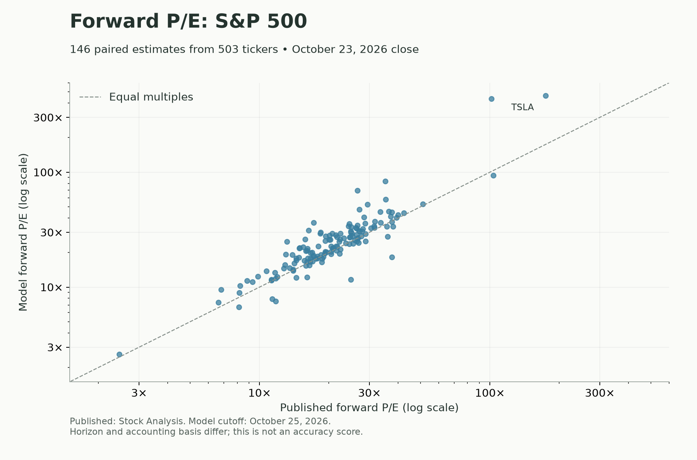
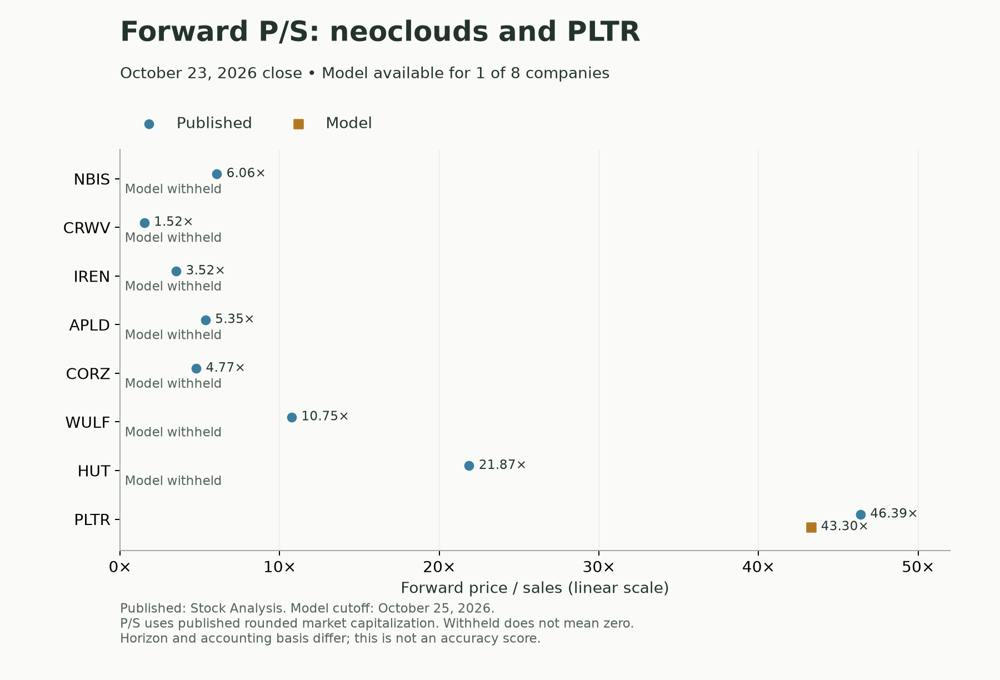

# Forward valuation model

A deterministic research model developed for [Utensil Desk](https://utensildesk.com), estimating forward price/earnings (P/E) and price/sales (P/S). Released by Stencia under the MIT license.

This is the calculation engine used for our initial forward-valuation comparisons. It is ordinary JavaScript, with no trained AI weights, runtime dependencies, network requests or provider credentials. The calculation and SEC adapter are extracted unchanged from our application. See [METHODOLOGY.md](METHODOLOGY.md) for the assumptions, accounting safeguards and offline evaluation commands.

## Use by Utensil Desk

As of October 25, 2026, this model is used for Utensil Desk's research comparisons. It does **not** power the live site's reader-facing forward valuation figures. Publishing the source and comparison graphs is not a production rollout.

The initial historical evaluation did not show consistent earnings-forecast improvement over repeating the latest four reported quarters. The broader current comparison produced P/E estimates for 146 of 503 S&P 500 tickers, and P/S for one of the eight neocloud/PLTR comparison companies. These coverage counts do not measure predictive accuracy.

Before general release, we need broader independent historical validation, reliable reporting-period and share-basis handling, and verified treatment of unsupported businesses and rapid business transitions. Any future integration should identify these as Utensil Desk model estimates, expose their forecast period and source methodology, and preserve withholding when inputs are inadequate. This section will be updated when production use is verified.

## Comparison previews

Snapshot retrieved October 25, 2026, using October 23 closing prices and model inputs available by October 25. Published multiples come from [Stock Analysis](https://stockanalysis.com/list/sp-500-stocks/), using each company's statistics page. These are dated research comparisons, not live quotes.





The P/E comparison uses the same published closing price for both multiples. P/S uses published rounded equity market capitalization. The model forecasts the next four unreported fiscal quarters; published forward horizons and adjusted/GAAP bases have not been reconciled. Differences are contextual, not forecast-accuracy scores. Withheld estimates are not zero. See [the methodology](METHODOLOGY.md) for eligibility safeguards.

## Development and model attribution

The initial implementation was developed with **OpenAI GPT-6 through Codex**, at Stencia's direction. This identifies the model family reported in the development session; the exact variant and checkpoint were not independently verified or recorded. It should not be read as a more precise model identifier.

The LLM helped write the implementation, documentation and tests. It is not part of the valuation engine at runtime: running this package does not call an LLM, load trained weights or require an OpenAI account.

The financial methods are conventional: forecast revenue growth, operating margins, taxes and diluted shares, then calculate P/E and P/S from the resulting earnings and revenue. We did not invent these techniques. Our contribution is their implementation and combination, including the specific assumptions, input handling and safeguards documented here. No existing valuation-model package or pretrained valuation weights were imported into this implementation.

The LLM's training informed its output, but we cannot identify which specific training sources influenced this code or these formulas. We have not established that every formula or code pattern is novel or unique. “Our model” means the implementation we maintain, not a claim that its underlying methods were invented independently of prior work. Open-sourcing it makes those choices inspectable and reproducible; it does not establish originality or forecasting accuracy.

## Run

Node.js 22 or newer is required. No dependency installation is needed.

```sh
git clone https://github.com/Stencia/forward-valuation-model.git
cd forward-valuation-model
npm test
npm run example
```

The example uses entirely synthetic quarterly statements and a synthetic quote. It prints a base forward P/E of approximately 8.61 and forward P/S of 1.65.

## Use

```js
import { forecastFundamentals, priceForwardForecast } from './docs/core/forward-valuation-model.js';

const forecast = forecastFundamentals({ quarters, asOf: '2025-02-01', currency: 'USD' });
const valuation = priceForwardForecast(forecast, {
  price: 100, marketCap: 1000, date: '2025-01-31',
  currency: 'USD', shareBasis: 'common', source: 'Your quote source',
});
```

Supply eight consecutive quarters, with publication dates and consistent currency, units and share basis. Each quarter has `start`, `end`, `knownAt`, `currency`, `revenue`, `operatingIncome`, `pretaxIncome`, `tax`, `netIncome` and `dilutedShares`. Monetary amounts and share counts must use consistent units so EPS is in the quote's per-share currency. Market capitalization must use the same monetary units as revenue. The executable example supplies the complete input shape.

Check `status` before reading results. A forecast can retain revenue while withholding EPS, with `earningsReason` explaining why. Low, base and high scenarios are sensitivity assumptions, not confidence intervals. P/E is price divided by projected EPS; P/S is equity market capitalization divided by projected revenue. All outputs retain the input provenance supplied by the caller.

## Scope and limitations

- Projects the next four **unreported fiscal quarters**, which can include an elapsed quarter. This is not rolling next-twelve-months or necessarily the next fiscal year.
- Projects seasonal revenue from historical growth, then earnings from margins, taxes and diluted shares. Optional revenue guidance must match the forecast horizon exactly.
- Uses GAAP inputs and mechanical assumptions, not analyst consensus adjustments or company-specific business-driver research.
- Includes a US GAAP/USD SEC Company Facts adapter and an offline historical evaluator. The adapter excludes financial SIC codes 6000 through 6799; this broad filter can also exclude firms outside conventional finance.
- Withholds forecasts for unsupported or inadequate inputs, extreme historical growth and other accounting safeguards. Coverage is intentionally incomplete, particularly for rapidly changing companies.
- Agreement with published multiples is not evidence of forecast accuracy. Accounting basis and forecast horizon can differ. Historical evaluation uses current restatements as realized outcomes and overlapping windows; see the methodology.
- This initial research release is not a validated production forecasting service, fair-value estimate, price target or trading signal.

The release contains source code, documentation, synthetic tests and dated comparison images. It does not include the downloaded input or comparison datasets. Obtain your own input data and respect its provider terms. No vendor data redistribution rights are granted by the code license. The package is marked private solely to prevent accidental npm publication; the GitHub source is public and MIT licensed.

## Contributing

Run `npm test` and `npm run example` before submitting a pull request. Include a synthetic regression case for behavioral changes, document changes to assumptions and bump the model version when forecasts change. Keep credentials, account information and downloaded datasets out of commits. Reports and input snapshots belong in the ignored `artifacts/` directory.
